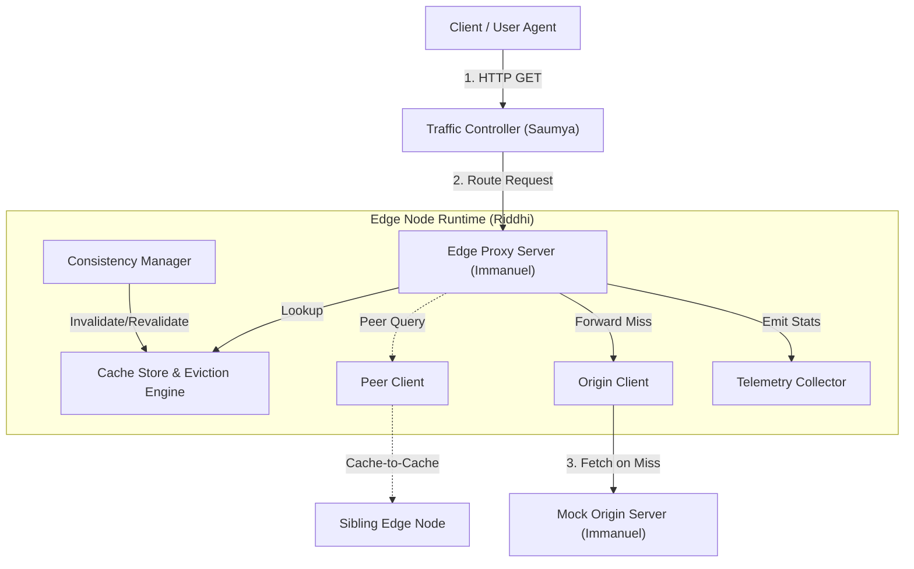
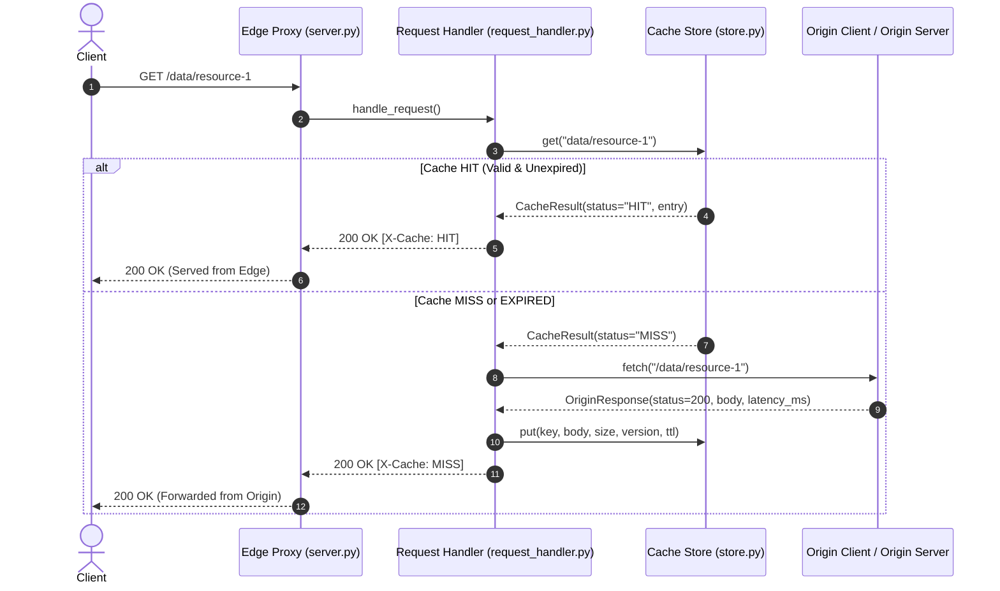
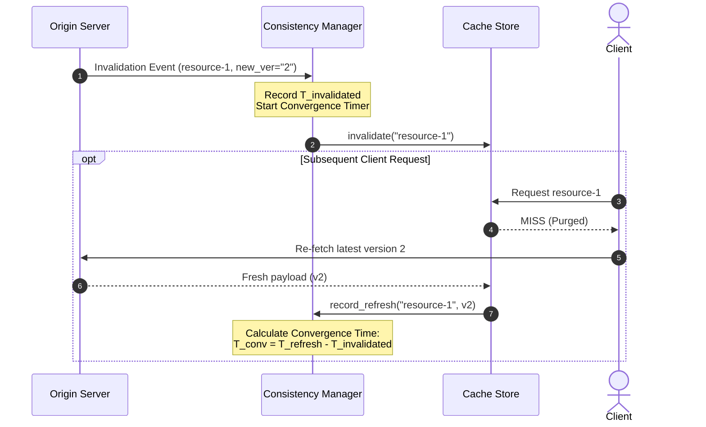

# System Architecture & Technical Specifications

**Adaptive Edge Caching Architecture**  
**Author:** Immanuel G (Lead for Proxy, Cache Engine, Consistency, and Contracts)

---

## 1. Architectural Overview

Adaptive Edge Caching sits between end clients and the authoritative origin server. Edge proxy nodes intercept incoming HTTP requests, maintain high-speed in-memory cached content, and dynamically optimize storage utilization using a multi-factor adaptive utility scoring policy.



---

## 2. Core Subsystems (Immanuel's Domain)

### 2.1 Mock Origin Server (`src/origin/server.py`)
Provides deterministic test environments with:
- **Adjustable Latency:** Simulated propagation and processing latency configurable via server defaults or per-request query param `?latency_ms=X`.
- **Dynamic Payload Sizing:** Produces reproducible synthetic payloads of custom byte length via `?size=N`.
- **Resource Versioning & Mutation:** Maintains logical versions, ETags, and timestamps. Resources mutate via `POST /update/{id}` or `PUT /data/{id}`, triggering version transitions to test cache consistency.
- **Conditional HTTP Support:** Evaluates `If-None-Match` to return `304 Not Modified`.

---

### 2.2 Edge Proxy Server (`src/proxy/`)



Key features:
- **URL Normalization:** Strips superfluous query parameters while deterministically sorting significant query arguments.
- **Cache-Control Adherence:** Obeys client `Cache-Control: no-cache` directives with `X-Cache: BYPASS`.
- **Latency Instrumentation:** Measures internal lookup latency (`X-Cache-Lookup-Time-Ms`) versus upstream retrieval latency (`X-Origin-Latency-Ms`).

---

### 2.3 Cache Engine & Adaptive Policy (`src/cache/`)

#### The Base Eviction Interface (`base.py`)
Agreed week-1 seam for all eviction strategies:
```python
class BaseEvictionPolicy(ABC):
    def on_insert(self, key: str, metadata: CacheMetadata) -> None: ...
    def on_access(self, key: str, metadata: CacheMetadata) -> None: ...
    def on_evict(self, key: str) -> None: ...
    def select_victim(self, candidates: Mapping[str, CacheMetadata], needed_bytes: int) -> Optional[str]: ...
```

#### Policies Implemented
1. **LRU (`lru.py`):** Evicts least recently accessed entries.
2. **LFU (`lfu.py`):** Evicts entries with lowest frequency of accesses (tie-break on recency).
3. **TTL (`ttl.py`):** Prioritizes entries closest to expiration or already expired.
4. **Adaptive Policy (`adaptive.py`):** Multi-metric utility maximization.

#### Mathematical Formulation of Adaptive Scoring
For object $o \in \mathcal{C}$ where $\mathcal{C}$ is the candidate set:

$$\tilde{f}(o) = \text{Norm}(f(o)), \quad \tilde{r}(o) = \text{Norm}\left(\frac{1}{1 + \Delta t(o)}\right)$$
$$\tilde{L}(o) = \text{Norm}(L_{\text{origin}}(o)), \quad \tilde{B}(o) = \text{Norm}(B(o)), \quad \tilde{S}(o) = \text{Norm}(S_{\text{bytes}}(o))$$

Let capacity pressure be defined as:
$$P = 1.0 - \frac{C_{\text{remaining}}}{C_{\text{total}}}$$

Then the utility score $U(o)$ is computed as:
$$U(o) = w_f \cdot \tilde{f}(o) + w_r \cdot \tilde{r}(o) + w_l \cdot \tilde{L}(o) + w_b \cdot \tilde{B}(o) - (w_s + w_c \cdot P) \cdot \tilde{S}(o)$$

The eviction engine selects the object with minimal utility:
$$o^* = \arg\min_{o \in \mathcal{C}} U(o)$$

This guarantees that:
- Objects with high origin latency $L(o)$ are retained (saving costly round trips).
- Frequently and recently referenced items are retained.
- As the cache nears capacity ($P \to 1.0$), larger items face increasing eviction pressure.

---

### 2.4 Consistency & Invalidation Subsystem (`src/consistency/`)



- **Stale Response Detection:** Compares served version against `target_version` when invalidation is active.
- **Convergence Telemetry:** Logs structured JSON entries tracking exact convergence time $T_{\text{conv}}$ and counts of any intermediate stale hits.

---

## 3. Concurrency and Thread Safety
- `CacheStore` is protected by reentrant locks (`threading.RLock`) ensuring atomic reads, inserts, and eviction loops across concurrent client worker threads.
- Server instances use `ThreadingHTTPServer` to service concurrent requests simultaneously without blocking.
