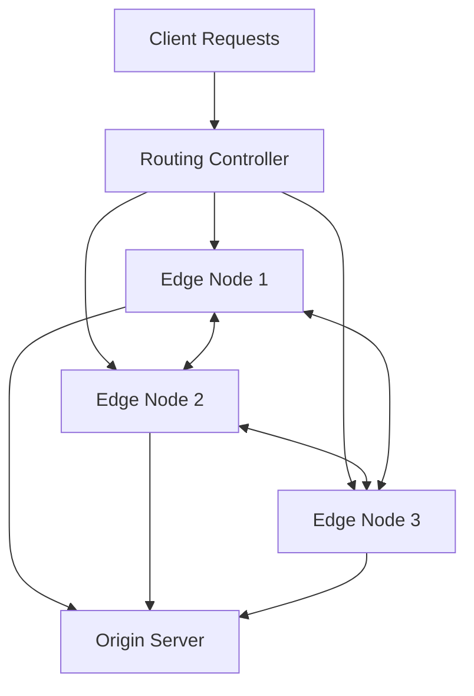

# System Architecture

## Overview
Adaptive Edge Caching provides a distributed edge-computing caching tier situated between end-user clients and origin services.

## Components
- **Proxy**: Intercepts requests, serves cache hits, forwards misses.
- **Cache Engine**: Implements eviction strategies (LRU, LFU, TTL, Adaptive).
- **Edge Node**: Host service running proxy, cache store, and peer coordinator.
- **Routing Controller**: Monitors node loads and routes requests intelligently.
- **Telemetry**: Gathers live metrics (latency, cache hit ratio, eviction rate).
- **Consistency**: Coordinates cache invalidations.
- **Origin Server**: Acts as the backend source of truth.
